# Woodex OS: Master Plan

**Project:** Woodex OS, the complete sales, communication and website system for Woodex Interior / Woodex Furniture
**Date:** 15 October 2026 · **Version:** 1.0 · **Branch:** `arena/8be318a2-woodexinterior`
**Inputs:** `00-DEEP-ANALYSIS.md` · owner answers recorded in `07-DECISIONS.md`
**Next documents:** `02-MASTER-PRD.md` (requirements) · `03-MASTER-SYSTEM-PROMPT.md` (build rules for AI agents)
· `04-DATABASE-SCHEMA.md` · `05-DESIGN-SYSTEM.md` · `06-DEPLOYMENT-HOSTINGER.md`

---

## 0. Summary

Woodex OS is **one Laravel 13 application** on the existing Hostinger hosting. It replaces the static
brochure site and the fragile v2.1/v2.5 admin with a single connected system:

```
 Visitor / client                      Woodex team                         Owner on mobile
 ───────────────                       ───────────                         ───────────────
 Website (142 URLs, Preline blocks)    Admin (TailAdmin + Livewire)        Telegram bot
 Chat widget · Estimator · Booking     CRM · Quotes · Invoices · Projects  Alerts · digests
 WhatsApp · Facebook · Instagram       Unified Inbox · Automations         /today /leads /approve
 LinkedIn · Lead Ads · Phone           Website & Theme builder · Social    /idea → change requests
            │                                     │                                │
            └──────────────► ONE DATABASE: contacts → leads → quotes → projects → invoices → payments
```

**Delivery:** 10 phases (P0–P9) take about **24–25 weeks with one developer + AI agent**, or about
**15–16 weeks with two developers**. The first business release, the **Sales OS** (CRM + quotations +
invoices with the old data migrated), arrives after **P3 (≈ 10 weeks)**. This follows the owner's
decision that sales comes first (D-06).

---

## 1. Goals and how we measure them

| # | Business goal | Metric (dashboard card) | Target |
|---|---|---|---|
| G1 | Never lose a lead | % of enquiries stored with source + phone | **100%** (today's static form stores 0%) |
| G2 | Answer fast | Median first response (business hours) | **< 15 min**; SLA breach alert to Telegram |
| G3 | Convert more | Lead → visit → quote → won conversion | Baseline in first 60 days, then **+20%** |
| G4 | Quote faster and more professionally | Visit → quote sent, median | **≤ 48 h**; quotes built from templates in < 15 min |
| G5 | Get paid on time | Receivables older than 30 days | **−50%** within 3 months of P3 |
| G6 | Run the business from a phone | Critical alerts delivered | **100%**, under 60 s for new leads (sent immediately after the request) |
| G7 | Keep and grow SEO | Organic clicks after website cut-over | **≥ 95%** of the previous level in 8 weeks, then growth |
| G8 | Fast website | Core Web Vitals (mobile, p75) | LCP < 2.5 s · INP < 200 ms · CLS < 0.1 |
| G9 | Owner can restyle and edit without a developer | Theme/page changes published by staff | No code change needed for content, colours, fonts or sections |

---

## 2. The recommended framework

### 2.1 Technical framework: "TALL + Preline" on Hostinger

| Layer | Choice | Why this and not something else |
|---|---|---|
| Language/runtime | **PHP 8.4** | Hostinger offers PHP 8.2–8.5 and SSH/cron. PHP is the safest fit for shared hosting. |
| Framework | **Laravel 13** (modular monolith) | Mature, huge ecosystem (permissions, media, backups, PDF), runs well on LiteSpeed shared hosting. |
| Admin UI | **Livewire 4** (class components) + **TailAdmin** layout + **Preline v5** components | Reactive screens without a separate SPA or API, so one developer can move fast. TailAdmin gives a proven dashboard shell (MIT). Preline gives polished components and blocks. |
| Styling | **Tailwind CSS 4.3** with one token system (`@theme` + Preline semantic variables) | One design language for admin, website, PDFs and emails. Runtime CSS variables let the theme builder work without rebuilding. |
| Public JS | **Alpine.js** islands + stateless JSON endpoints | Works with LiteSpeed full-page cache, so the site is very fast and handles traffic spikes. |
| Data | **MySQL 8 / MariaDB** with real foreign keys, enums and money as integers | Fixes the old JSON-blob money model. Makes reports possible. |
| Background work | Database queue, run by cron every minute | Shared hosting cannot keep a worker running. Urgent alerts are sent right after the HTTP response instead. |
| Real-time | Laravel Broadcasting → Pusher/Ably free tier, polling fallback | Live inbox and dashboard without a websocket server. |
| Quality | Pest 5 · Larastan · Pint · GitHub Actions | Every push is tested. CI is the referee. |

**Rejected alternatives**:

| Alternative | Why not |
|---|---|
| Filament | The owner chose a custom admin (D-01). Filament also gives less control over the sales UX. |
| Next.js / Node | No Node runtime on Hostinger shared hosting. |
| WordPress + plugins | Weak fit for quotes and invoices. Plugin sprawl. |
| Continuing v2.1 | JSON money blobs, no foreign keys, leaked secrets. See R1–R8 in the analysis. |

### 2.2 Delivery framework: "Docs → Phase Cards → CI-gated slices"

1. **Single source of truth.** Read the documents in this order: `07-DECISIONS` → `01-MASTER-PLAN` →
   `02-MASTER-PRD` → `04-DATABASE-SCHEMA` → `05-DESIGN-SYSTEM` → `03-MASTER-SYSTEM-PROMPT`. If code and
   docs disagree, the docs win until someone updates them.
2. **Phase cards.** Each phase (P0–P9) has a goal, scope, deliverables and **exit criteria**
   (§7 and the system prompt). Work is built as **vertical slices**: migration → model → policy →
   Livewire screen → notifications → tests, one feature at a time.
3. **Definition of Done.** CI green · tests for the business rules · permissions enforced · audit logged
   · empty/loading/error states · mobile layout checked · docs/STATE updated.
4. **Release train.** Branch → CI → **staging** subdomain → owner check → production deploy with an
   automatic backup and a one-command rollback.
5. **Change control from mobile.** The owner sends `/idea …` or `/issue …` to the Telegram bot. It
   becomes a **change request** in the admin, which is triaged weekly into the next phase card.

---

## 3. System architecture

### 3.1 Logical modules (one app, clear boundaries)

```
platform/app/
├── Domain/
│   ├── Crm/            contacts, companies, leads, pipeline, tasks, site visits, scoring, assignment
│   ├── Sales/          quotations, templates, rate book, invoices, payments, receipts, bank accounts
│   ├── Projects/       projects, stages, milestones, client updates, client portal
│   ├── Conversations/  inbox, channels (web chat, WhatsApp, Messenger, IG, LinkedIn), chatbot, canned replies
│   ├── Automation/     sequences, triggers, alert rules, schedules, SLA timers
│   ├── Marketing/      social accounts, posts, calendar, lead ads, UTM attribution, reviews
│   ├── Cms/            pages, blocks, themes, menus, collections, redirects, 404 log, SEO
│   └── System/         users, roles, settings, integrations, audit, health, backups, importer, change requests
├── Integrations/       WhatsApp, Telegram, Meta, LinkedIn, AI, Realtime, Turnstile (interfaces + drivers + fakes)
├── Livewire/Admin/**   admin screens (TailAdmin layout)
├── Http/Controllers/   public site, public JSON API, webhooks, signed client links
└── Support/            Money, Phone, NumberSequence, Pdf, Html sanitising, helpers
```

### 3.2 Runtime view on Hostinger

```
             ┌─────────────── Hostinger shared hosting (LiteSpeed, PHP 8.4, MySQL) ───────────────┐
 Browser ───►│ woodex.com.pk (P6+)  ─┐                                                            │
 (visitor)   │                       ├─► Laravel public/ ─► routes: site · /api/public · /webhooks │
 Browser ───►│ admin.woodex.com.pk  ─┘          │             ▲                                  │
 (staff)     │                                  ▼             │ LiteSpeed page cache (public only)│
             │                         MySQL (woodex_os)      │                                  │
             │  hPanel cron (every min): php artisan schedule:run                                 │
             │      ├─ queue:work --stop-when-empty --max-time=50   (jobs: messages, PDFs, sync)  │
             │      ├─ automations:tick  (sequences, SLA timers, reminders)                       │
             │      └─ daily: backup:run · digests · sitemap · token refresh · cleanup            │
             └──────────────────────────────────────────────────────────────────────────────────┘
                    │ HTTPS out                                   ▲ webhooks in
                    ▼                                             │
   WhatsApp Cloud API · Telegram Bot API · Meta Graph · LinkedIn · AI provider · Pusher/Ably · SMTP · Turnstile
```

### 3.3 The core data spine (hierarchy improved over v2.1)

v2.1 kept **leads** and **clients** as two separate copies of the same person. Woodex OS uses **one
contact record** and a pipeline of **opportunities (leads)**:

```
Company (optional) ─┐
                    ▼
                 Contact ──< Lead (opportunity: line, service, area, budget, stage, owner)
                    │           ├──< Activity / Task / Site visit
                    │           └──< Quotation ──< Revision (immutable snapshot) ──< Events (sent, viewed, accepted)
                    │                    │ accepted
                    │                    ▼
                    │                 Project ──< Milestone ──< Invoice ──< Payment allocation >── Payment
                    │                    └──< Client update (photos) → portal / WhatsApp
                    └──< Conversation (web, WhatsApp, Messenger, IG, LinkedIn) ──< Message
```

A contact becomes a **client** automatically when their first quotation is accepted.

---

## 4. Admin information architecture (new navigation)

The old admins had flat menus with 20–30 items. The new sidebar groups screens **by job to be done**.
Each user sees only what their role allows.

| Group | Screens | Main users |
|---|---|---|
| **Overview** | Dashboard (real-time KPIs + "needs attention") · My Day · Approvals · Notifications | everyone |
| **CRM** | Leads (List ⇄ Pipeline board) · Contacts · Companies · Tasks · Site Visits (calendar) · Segments | sales |
| **Sales** | Quotations · Invoices · Payments · Receivables (aging) · Quote Templates · Rate Book | sales, accountant |
| **Projects** | Projects (board/list) · Schedule (milestones) · Client Updates | PM/designer |
| **Inbox** | All conversations · Website chat · WhatsApp · Facebook · Instagram · LinkedIn | sales, support |
| **Automation** | Follow-up Sequences · Alert Rules · WhatsApp Templates · Broadcasts · Chatbot | manager |
| **Marketing** | Social Planner (calendar) · Posts · Lead Ads · Sources & UTM · Reviews | marketing |
| **Website** | Pages · Blocks · Theme Builder · Menus · Media · Collections · Forms · SEO & Redirects | editor |
| **Reports** | Funnel · Revenue & Collections · Sources & ROI · Team · Response Times · Website · Social | owner, manager |
| **System** | Settings · Users & Roles · Integrations · Data Import · Audit Log · Health & Backups · Change Requests | owner, admin |

Cross-cutting UI: **global search (Ctrl/⌘ K)** by name, phone (any format) or document number ·
**quick-add** (+ Lead, + Quote, + Task) · **notification bell** · **record drawers**, so a list never loses
your place.

---

## 5. Core flows

### 5.1 Lead-to-cash

```mermaid
flowchart LR
  A[Enquiry: web form / estimator / booking / chat / WhatsApp / FB-IG DM / Lead Ad / LinkedIn / phone] --> B[Lead Capture Service]
  B -->|normalise +92 phone, dedupe contact, UTM + source| C[Lead: New]
  C --> D{Auto-assign rule}
  D --> E[Telegram + in-app alert to owner of lead; auto-reply to client on WhatsApp]
  E --> F[Contacted]
  F --> G[Site visit booked → reminders → visit outcome + measurements/photos]
  G --> H[Quotation from template + rate book]
  H -->|discount above limit| I[Approval by owner on Telegram/admin]
  H --> J[Send: WhatsApp link + PDF + email]
  I --> J
  J --> K[Tracking: viewed / reminder sequence / revision requested]
  K -->|accepted online| L[Won → contact becomes client]
  K -->|lost + reason| X[Lost → nurture]
  L --> M[Project created + advance invoice 50% or 75%]
  M --> N[Payment proof / bank transfer → accountant verifies → receipt]
  N --> O[Project stages + photo updates → milestone invoices 40% / 10%]
  O --> P[Handover → review request → portfolio case study]
```



### 5.2 Conversation flow (chat bot + humans)

1. A message arrives (website widget, WhatsApp, Messenger, IG DM). It is stored in `messages` and the
   conversation is linked to a contact. A contact is created when a phone number or email is learned.
2. **Bot mode** (default outside hours, optional inside hours) answers from the knowledge base, qualifies
   the enquiry (service, property, area, location, budget band, timeline), captures name + WhatsApp, and
   offers a site-visit slot.
3. **Hand-off** to a human happens when the client asks for one, the bot's confidence is low, the client
   complains or wants to negotiate a price, or the bot hits its turn limit. The assigned staff member gets
   an in-app + Telegram alert. The SLA timer starts.
4. Every conversation can be turned into a lead with one click, or automatically once qualification is
   complete. The transcript is attached to the lead timeline.
5. **WhatsApp cost awareness:** from 1 Oct 2026 Meta charges per message. Pakistan reported rates:
   marketing ≈ $0.047, utility ≈ $0.015, service replies free for the first 1,000 per number per month and
   then ≈ $0.015. The bot therefore writes **fewer, combined messages**. A **usage meter** shows the
   month's message counts and estimated cost, and Telegram alerts at thresholds.

### 5.3 Alert flow (Telegram as the mobile command centre)

Event → Alert Rule (who, which channel, quiet hours, priority) → in-app notification + Telegram
message with **inline buttons** (Assign to me · Mark contacted · Approve · Open). Critical events are sent
immediately after the HTTP response. Everything else goes through the queue, which runs at most a minute
later. Daily digest at 09:00, weekly report Monday 09:00.

### 5.4 Website publishing flow

Editor edits a page (blocks) → **preview** (signed URL) → **publish** creates a version, purges the
cache, updates the sitemap and runs SEO checks (one H1, meta, alt text, links). The theme builder edits
tokens → preview → publish writes a small versioned CSS file (no rebuild) → instant site-wide restyle →
**rollback** to any previous version.

---

## 6. Integrations

| Integration | Used for | How | Approval / setup needed | Cost (verify before launch) | Phase |
|---|---|---|---|---|---|
| **WhatsApp Cloud API** | Inbox, bot, templates (quote sent, invoice, reminders), follow-ups | Graph API + signed webhooks | Meta Business verification, display name, template approval, number registration | Per message. PK reported: marketing ≈ $0.047, utility ≈ $0.015, service free up to 1,000/month per number | P4 |
| **Telegram Bot API** | Staff alerts, digests, commands, approvals, change requests | Bot API webhook with secret token | Create bot with @BotFather | Free | P1 (alerts) · P5 (commands) |
| **Meta Graph** (Pages, Messenger, Instagram) | Social inbox, comments, Lead Ads → CRM, post publishing | Facebook Login for Business + webhooks | **App Review** for advanced permissions + Business verification | Free | P7 |
| **LinkedIn** | Company page posting, comments, Lead Gen forms | Community Management API, Lead Sync API | **LinkedIn product access approval** (can take weeks). DMs are not available via API. | Free | P7 |
| **AI provider** (Claude default; OpenAI/Gemini) | Chat bot, reply suggestions, summaries, post drafts | REST with daily cost cap | API key | ≈ $10–40/month at Woodex volumes | P4 |
| **Pusher Channels / Ably** | Real-time inbox, dashboard, chat widget | Laravel Broadcasting (Pusher protocol) | Free account | Free tier first | P4 |
| **Cloudflare Turnstile** | Spam protection on public forms and chat | Server-side verify | Free account | Free | P1 |
| **SMTP** (Hostinger mail) / Resend / Brevo | Transactional email | Laravel Mail | Mailbox + SPF/DKIM/DMARC | Included / free tier | P1 |
| **Google Analytics 4 + Search Console** | Traffic and SEO cards in Reports | GA4 Data API, GSC API (service account) | Add service account to properties | Free | P6 |
| **IndexNow / sitemap ping** | Faster indexing after publish | HTTP ping | Key file | Free | P6 |
| Payment gateway (optional, later) | Pay invoice online | JazzCash / Easypaisa / Safepay / PayFast | Merchant account | % per transaction | After P9 |

All keys are entered in **System → Integrations**, stored encrypted, and each has a **Test connection**
button plus a health check that alerts on Telegram when a token expires or a webhook stops arriving.

---

## 7. Roadmap: phases, deliverables and exit criteria

Start **Mon 19 Oct 2026**. Dates assume one developer + AI agent. Two developers run P4/P6 in parallel
with P2/P3.

| Phase | Weeks | Window (1 dev) | Goal | Key deliverables | Exit criteria |
|---|---|---|---|---|---|
| **P0 Foundation** | 2 | 19 Oct → 30 Oct | A running, secure skeleton | Laravel 13 app in `platform/` · TailAdmin+Preline shell with Woodex nav · auth + 2FA · roles · settings · Money/Phone/NumberSequence · CI · staging deploy | CI green · staging login works · roles seeded · cron + queue proven on Hostinger |
| **P1 CRM + capture** | 3 | 2 Nov → 20 Nov | Every enquiry becomes a lead | Contacts/companies · leads list + pipeline board · tasks · site visits · assignment + SLA · public lead API (+ Turnstile) · bridge for the live site forms · Telegram alerts (new lead, SLA) · **v2.1 importer (CRM part)** | New web lead appears in < 5 s with a Telegram alert · import dry-run report matches v2.1 counts |
| **P2 Quotations** | 3 | 23 Nov → 11 Dec | Professional quotes in minutes | Rate book · 16 templates (seeded from real BOQs) · builder (sections, items, discounts, terms, milestones) · approvals · PDF (EN) · signed client link · view tracking · online accept · revisions · reminders · **v2.1 quotes import** | Quote built from template < 15 min · totals match tests to the paisa · accept link creates "won" + notifications |
| **P3 Invoices + payments** | 2 | 14 Dec → 25 Dec | Get paid on time | Milestone invoices from accepted quote · manual invoices · payment recording + proof upload + verification · receipts · bank routing (Interior/Furniture) · aging report · reminders · Project-lite (record + stages) · **v2.1 invoices/projects import** | **Release 1: Sales OS live on admin subdomain** · import checksums equal · accountant sign-off |
| **P4 Conversations** | 3 | 28 Dec → 15 Jan | Talk to clients from one inbox | WhatsApp Cloud API (send/receive/media/status/templates/opt-out) · unified inbox · website chat widget · AI bot + knowledge base + hand-off · sequences (follow-ups) · real-time broadcasting · usage meter | WhatsApp round-trip works with signed webhooks · bot hands off correctly · cost meter shows the month |
| **P5 Telegram command centre** | 1 | 18 Jan → 22 Jan | Run the business from a phone | Staff linking · alert matrix · digests · commands (/today /leads /lead /quotes /due /visits /report /health /approve /assign /note /idea /issue) · health monitor (cron heartbeat, failed jobs, backups, tokens) | Owner completes a full day of approvals from Telegram |
| **P6 Website + builders** | 4 | 25 Jan → 19 Feb | New fast website, same SEO | Studio-look Preline block library · page types (service, area, insight, project, landing) · **142-URL import + parity test** · theme builder (tokens) · page builder · menus · media · forms · estimator · booking · chat widget · SEO (meta, schema, sitemap, redirects, 404 log) · GA4/GSC cards | Parity test 142/142 green · CWV targets on staging · **Release 3: website cut-over** with 301 map |
| **P7 Social** | 3 | 22 Feb → 12 Mar | Social leads and content in one place | Meta connect · Messenger/IG DMs + comments in inbox · Lead Ads → CRM · composer + scheduler + calendar + approvals · LinkedIn posting (+ Lead Sync when approved) | Lead Ad test lead lands in CRM < 1 min · scheduled post publishes on time |
| **P8 Projects + client portal** | 2 | 15 Mar → 26 Mar | Delight clients after "won" | Project board · milestones · photo updates → WhatsApp/portal · client portal (quotes, invoices, payments, updates, documents) · handover checklist · review request · case-study draft | Client can see the project status and pay/upload proof from the portal |
| **P9 Hardening + handover** | 2 | 29 Mar → 9 Apr 2027 | Safe, documented, trained | Security review · load/perf pass · backup restore drill · Urdu templates · training videos/runbooks · final data sync · v2.1 retired (read-only archive) | All PRD "Must" items accepted · restore drill passed · team trained |

**Buffers:** Ramadan and Eid ul-Fitr are expected in **Feb–Mar 2027**. Meta and LinkedIn approvals can
take weeks, so they are **requested in P0** even though the features land in P4/P7.

### 7.1 Two-developer variant (≈ 15–16 weeks)

- **Dev A:** P0 → P1 → P2 → P3 → P8 → P9.
- **Dev B:** P4 (from week 3) → P5 → P6 → P7.
- **Release 1** stays at week ≈ 10, the website at week ≈ 12, and social at week ≈ 14.

---

## 8. Effort estimate (for planning and quoting)

| Phase | Dev hours (1 dev + AI) | Owner/team time needed |
|---|---|---|
| P0 | 70 | 2 h: Hostinger access, domains, logo files |
| P1 | 110 | 4 h: pipeline rules, assignment rules, test enquiries |
| P2 | 115 | 6 h: review templates/rate book, terms, signatories, sample quotes |
| P3 | 75 | 4 h: bank details, invoice rules, accountant review |
| P4 | 115 | 5 h: Meta verification, WhatsApp templates (EN/UR), bot knowledge review |
| P5 | 40 | 1 h: link Telegram accounts |
| P6 | 150 | 10 h: content review, photos of real projects, page approvals |
| P7 | 110 | 4 h: Meta/LinkedIn app access, page roles, calendar rules |
| P8 | 75 | 3 h: portal wording, handover checklist |
| P9 | 70 | 6 h: training, acceptance testing |
| **Total** | **≈ 930 h (≈ 24 weeks)** | **≈ 45 h** |

To turn this into a price: **hours × hourly rate**, plus **15% contingency** for API approval delays and
content work. The AI agent reduces typing time, not decision or testing time, so the estimate already
assumes AI assistance.

### 8.1 Running costs (monthly, estimates to verify)

| Item | Estimate | Notes |
|---|---|---|
| Hostinger hosting + domain | Existing plan | Needs SSH, cron, MySQL. Business or Cloud plan recommended. |
| WhatsApp Cloud API | ≈ $15–40 | Example: 300 utility + 200 marketing + 1,500 service msgs ≈ $4.5 + $9.5 + $7.5 ≈ **$21.5** |
| AI chat bot | ≈ $10–40 | Daily cap configurable. Bot falls back to human hand-off when the cap is reached. |
| Real-time (Pusher/Ably) | $0 | Free tier first; polling fallback means no hard dependency |
| Email | $0 | Hostinger mailbox; Resend/Brevo free tier optional |
| Off-site backups | $0–2 | Google Drive (free) or S3-compatible bucket |
| Cloudflare Turnstile, Telegram, Meta APIs, LinkedIn API | $0 | — |
| **Total** | **≈ $25–80 / month** | Excluding ad spend and optional Preline Pro licence (one-time) |

---

## 9. Migration and cut-over

### 9.1 Data from v2.1 (sales first)

1. Create a read-only MySQL user on the v2.1 database. Add it to `.env` as the `legacy` connection.
2. `php artisan woodex:import-v21 --dry-run` produces a report: counts per table, duplicates merged by
   phone, orphans, totals of quotes/invoices/payments (money checksums), and a warnings CSV.
3. Fix data or mapping rules, then re-run. The import is **idempotent**: it is keyed on legacy IDs stored
   in `legacy_refs`.
4. **Cut-over day:** freeze v2.1 (read-only banner) → final import → DNS/subdomain switch → smoke tests →
   staff log in with **new passwords**.
5. v2.1 stays available **read-only for 90 days**, then is archived (database dump + files) off-server.

### 9.2 Website (P6)

1. Import content from the live static site (`frontend-v1` HTML) into page types and blocks. The
   importer keeps titles, meta, H1, body sections, FAQs and images.
2. The **parity test** requests all 142 URLs on staging (200 + canonical with trailing slash + no
   `noindex`).
3. Upload a **301 map** for any URL that changes (none planned). Old `.html` paths 301 to slash URLs.
4. Cut-over: switch the apex domain document root to Laravel `public/`. Purge the LiteSpeed cache.
   Submit the sitemap in Search Console. Watch the 404 log daily for 2 weeks.

### 9.3 Bridge period (P1 → P6)

The current live site keeps running. Its enquiry forms can post to the new
`https://admin.woodex.com.pk/api/public/leads` endpoint (CORS-restricted to `woodex.com.pk`). Web leads
then reach the new CRM from P1. This is a small change on the live site and needs the owner's approval.

---

## 10. Risks and mitigations

| Risk | Likelihood | Impact | Mitigation |
|---|---|---|---|
| Credentials leaked by the old public repo are still valid | High | Critical | **P0 blocker:** rotate every key (DB, SMTP, WhatsApp, Telegram, AI, Meta). New system never stores secrets in Git. |
| Meta App Review / business verification delays | Medium | High | Apply in P0. Build against test numbers/pages first. Click-to-chat fallback. |
| LinkedIn API access not granted | Medium | Medium | Posting via Community Management API first. Lead Gen via CSV/Zapier until Lead Sync is approved. DMs out of scope. |
| WhatsApp cost growth (per-message billing from Oct 2026) | Medium | Medium | Usage meter + thresholds. Bot writes combined messages. Marketing broadcasts only to opted-in contacts. |
| Shared hosting limits (CPU, process time, inodes) | Medium | Medium | Page cache, queue in small batches, image optimisation, nightly cleanup. Upgrade path to Hostinger Cloud/VPS without code change. |
| Old data quality (duplicates, JSON blobs) | High | Medium | Dry-run importer, phone-based dedupe, warnings CSV, manual review step. |
| SEO drop at website cut-over | Medium | High | 142-URL parity CI test, same paths, 301 map, schema, sitemap, 404 monitoring. |
| Urdu text in PDFs (dompdf shaping) | Medium | Low | Test in P2. mPDF fallback for Urdu templates. |
| Scope creep | High | Medium | Phase cards + change requests triaged weekly. "Must" vs "Should" in the PRD. |
| Single developer availability | Medium | High | Docs + system prompt let another developer or AI agent continue. CI + staging always deployable. |

---

## 11. Governance and operations

| Topic | Rule |
|---|---|
| Environments | Local (dev machine) → CI (GitHub Actions) → staging (`staging.woodex.com.pk`, `noindex`) → production |
| Branches | Work on feature branches. PR into the main line. CI must be green. Owner approves releases. |
| Deploys | `git pull` or zip + `composer install --no-dev` + `migrate --force` + `optimize` (see `06-DEPLOYMENT-HOSTINGER.md`). Automatic DB backup before each migrate. |
| Backups | Daily DB + weekly files (spatie/laravel-backup) → off-site. Monthly **restore drill**. |
| Monitoring | Health screen + Telegram: cron heartbeat, failed jobs, queue backlog, disk, backups, token expiry, error spikes, webhook silence. |
| Security | 2FA for owner/admin/accountant · least-privilege roles · signed URLs for client links · rate limits · CSP · HTML sanitiser for builder content · audit log. |
| Privacy | Consent text on forms · WhatsApp opt-in/opt-out · contact data export/erase on request · retention rules in Settings. |
| Documentation | `docs/` is updated in the same PR as the code. `platform/STATE.md` tracks phase progress. |

---

## 12. Open items for the owner

See `07-DECISIONS.md` §C (P-01…P-08). The most urgent ones:
1. **Rotate all old credentials** (P-06). This blocks go-live.
2. Confirm **WhatsApp number, email and hours** (P-01…P-03).
3. Confirm the **Hostinger plan + SSH access** (P-05).
4. Decide on a **Preline Pro** licence (P-04).
5. Start the **Meta Business verification** and **LinkedIn API access** requests (they take time).
