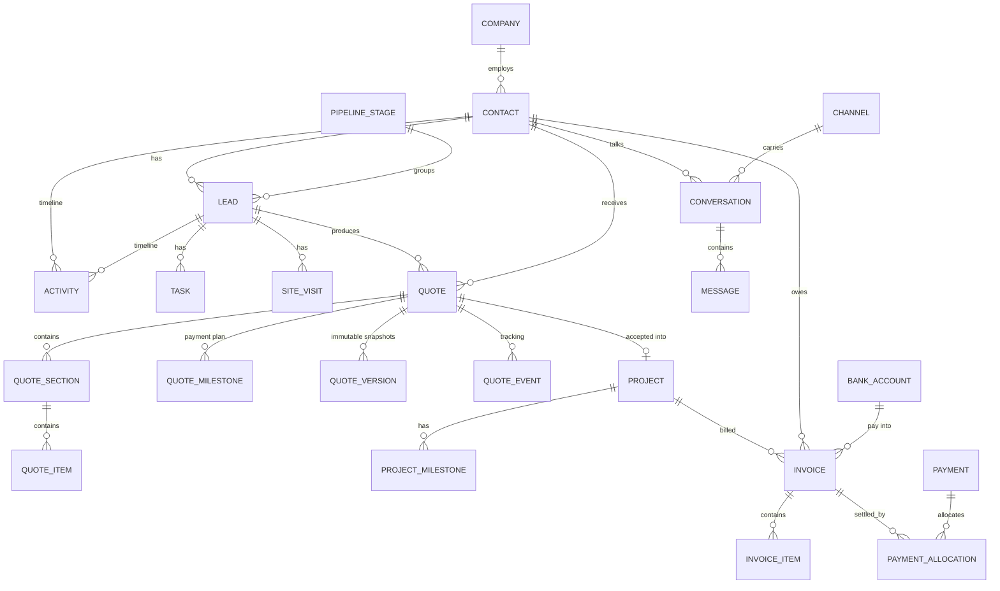

# Woodex OS: Database Schema

**Version:** 1.0 · **Date:** 15 October 2026 · **Engine:** MySQL 8 / MariaDB 10.6+ (InnoDB, `utf8mb4_unicode_ci`)
**Tests:** SQLite in memory (CI). Every migration must run on both.
**Implemented in code:** the tables marked ✅ exist in `platform/database/migrations` (P0 scaffold). Other
tables are specified here and are created in the phase shown.

---

## 1. Conventions (binding)

| Rule | Detail |
|---|---|
| Primary keys | `id BIGINT UNSIGNED AUTO_INCREMENT` |
| Public references | `public_id CHAR(26)` (ULID) for anything reachable by a client link (quotes, invoices, payments, projects, conversations). Links are also **signed + expiring**. |
| Money | `*_minor BIGINT` = **paisa** (Rs 1 = 100). Never `FLOAT`/`DECIMAL` for money. Currency column `CHAR(3) 'PKR'` on documents. |
| Quantities | `DECIMAL(14,3)` (fractional BOQ quantities like `121.125 sft`) |
| Percentages | `*_bp` = basis points (`5000` = 50.00%), unsigned int |
| Enums | `VARCHAR` + PHP backed enums (`app/Domain/**/Enums`), no MySQL `ENUM` (easier to extend, works on SQLite) |
| Phones | E.164 strings (`+923224000768`) in `VARCHAR(20)`, normalised by `App\Support\Phone` |
| Time | `TIMESTAMP` in UTC; displayed in `Asia/Karachi` |
| Soft deletes | `deleted_at` on business records (contacts, leads, quotes, invoices, payments, projects, tasks…) |
| Foreign keys | Always declared. `restrictOnDelete` for money-bearing parents, `cascadeOnDelete` for owned children, `nullOnDelete` for optional links (users, templates) |
| JSON | Only for non-money flexible data (attribution, meta, snapshots, blueprints, settings payloads) |
| Polymorphic types | Short aliases via `Relation::enforceMorphMap()` (`contact`, `lead`, `quote`, `invoice`, `payment`, `project`, `user`…) |
| Naming | snake_case plural tables; pivot `a_b` alphabetical; booleans `is_*`/`has_*`; timestamps `*_at`; dates `*_on` or `*_date` |

---

## 2. Entity relationship overview

---

## 3. System tables

### 3.1 `users` ✅ (skeleton + Woodex columns)
`id` · `name` · `email` (unique) · `phone` (E.164, null) · `title` (job title, null) · `is_active` (bool, default true)
· `locale` (`en`) · `email_verified_at` · `password` · `two_factor_secret` · `two_factor_recovery_codes`
· `two_factor_confirmed_at` · `remember_token` · `last_login_at` · `last_login_ip` · timestamps · `deleted_at`.
Same migration: `password_reset_tokens`, `sessions` (Laravel defaults).

### 3.2 Package tables ✅
| Table(s) | Package | Notes |
|---|---|---|
| `roles`, `permissions`, `model_has_roles`, `model_has_permissions`, `role_has_permissions` | spatie/laravel-permission 8 | Roles per D-21 |
| `activity_log` | spatie/laravel-activitylog 5 | Audit log (GLB-009) |
| `media` | spatie/laravel-medialibrary 11 | All files (attachments, proofs, photos, PDFs) |
| `settings` | spatie/laravel-settings 3 | Typed settings groups; secrets encrypted |
| `notifications` | Laravel | In-app notification centre |
| `cache`, `cache_locks`, `jobs`, `job_batches`, `failed_jobs` | Laravel | Database cache + queue |

### 3.3 `number_sequences` ✅
| Column | Type | Notes |
|---|---|---|
| `key` | varchar(50) unique | `quote.interior`, `quote.furniture`, `receipt`, `lead` |
| `prefix` | varchar(20) | `WI`, `WF`, `RC`, `L` |
| `next_number` | bigint unsigned | `10100`, `10050`, `1`, `1` |
| `padding` | tinyint | `0` (WI-10100) or `4` (RC-2026-0001) |
| `format` | varchar(60) | `{prefix}-{number}` · `{prefix}-{year}-{number}` |
| `reset` | varchar(10) | `never` · `yearly` |
| `period` | varchar(10) null | current year for yearly reset |

Allocation: `SELECT … FOR UPDATE` inside a transaction (`App\Support\NumberSequence::next()`), so two
users can never get the same number.

### 3.4 `webhook_events` ✅
`provider` (`whatsapp`, `meta`, `telegram`, `linkedin`) · `external_id` · `type` · `payload` json · `signature_valid`
· `status` (`received`, `processed`, `ignored`, `failed`) · `attempts` · `error` · `processed_at` · timestamps.
**Unique (`provider`, `external_id`)** gives idempotency, so a retried webhook is processed only once.

### 3.5 `integration_logs` ✅
`integration` · `direction` (`out`/`in`) · `action` · `status_code` · `ok` · `duration_ms` · `request` json (masked)
· `response` json (masked) · `error` · nullable morph `subject` · `created_at`. Pruned after 30 days.

### 3.6 `telegram_links` ✅
`user_id` (null for group chats) · `chat_id` (signed bigint, unique; group IDs are negative) · `chat_type` · `title`
· `username` · `link_code` (unique, one-time) · `link_code_expires_at` · `is_active` · `muted_until` · `preferences`
json · `linked_at` · timestamps.

Personal commands use verified human private sender/chat equality and an active staff link; group routing is not user authority. New linking codes are 16 characters, one-time and valid for at most 30 minutes (existing valid eight-character codes remain compatible until expiry/use). No new column is needed. See [Telegram hardening](25-TELEGRAM-CONSENT-HARDENING.md).

### 3.7 `alert_rules` ✅
`event` (e.g. `lead.captured`, `quote.viewed`) · `name` · `conditions` json · `recipients` json
(`{"roles":["sales_manager"],"users":[3],"assignee":true,"chats":[-100123]}`) · `channels` json
(`["telegram","in_app"]`) · `respect_quiet_hours` · `priority` · `is_active`.

### 3.8 `approvals` ✅
morph `approvable` · `type` (`discount`, `margin`, `void`, `refund`) · `status` (`pending`, `approved`, `rejected`,
`cancelled`) · `requested_by` · `decided_by` · `decided_at` · `reason` · `payload` json · `channel` (`admin`/`telegram`).

### 3.9 `change_requests` ✅
`type` (`idea`, `issue`, `bug`, `content`) · `title` · `body` · `priority` · `status` (`new`, `accepted`, `planned`,
`in_progress`, `done`, `rejected`) · `phase` · `source` (`telegram`/`admin`) · `requested_by` · `telegram_message_id`
· `resolution_note` · `resolved_at` · timestamps · soft delete. Attachments via media.

### 3.10 `legacy_refs` ✅
`legacy_table` · `legacy_id` · `model_type` · `model_id` · `checksum` · `imported_at`.
**Unique (`legacy_table`, `legacy_id`)**: this makes the v2.1 importer idempotent.

---

## 4. CRM tables (P1)

### 4.1 `companies` ✅
`name` · `type` (`company`, `developer`, `architect`, `other`) · `ntn` · `phone` · `email` · `website` · `address`
· `city` · `notes` · `owner_id` → users · timestamps · soft delete.

### 4.2 `contacts` ✅
| Column | Type | Notes |
|---|---|---|
| `company_id` | FK null | nullOnDelete |
| `name` | varchar(160) | Single name field (Pakistani names do not split cleanly); first word = greeting name |
| `phone` / `alt_phone` / `whatsapp` | varchar(20) null, indexed | E.164; dedupe searches all three |
| `email` | varchar(160) null, indexed | lower-cased |
| `city`, `area`, `address` | | e.g. Lahore / DHA Phase 6 |
| `client_type` | varchar(20) | `individual`, `company`, `developer`, `architect` |
| `preferred_language` | varchar(5) | `en` / `ur` |
| `is_client`, `became_client_at` | bool, ts | set on first accepted quote |
| `source` | varchar(40) | first-touch source |
| `owner_id` | FK users null | account owner |
| `consent_marketing`, `consent_whatsapp`, `opted_out_at` | | WAP-006 |
| `notes`, `meta` json, `last_activity_at` | | |

### 4.3 `tags` ✅ / `taggables` ✅
`tags(name, slug unique, color)` · `taggables(tag_id, taggable_type, taggable_id)` composite primary key.

### 4.4 `pipeline_stages` ✅
`key` unique · `name` · `position` · `type` (`open`/`won`/`lost`) · `probability` (0–100) · `color` · `is_active`.
Seeded: `new` (10) · `contacted` (20) · `site_visit` (40) · `quotation` (60) · `negotiation` (75) · `on_hold` (15) ·
`won` (100, won) · `lost` (0, lost).

### 4.5 `leads` ✅
| Column | Type | Notes |
|---|---|---|
| `ref` | varchar(20) unique | `L-2026-000123` |
| `contact_id` | FK restrict | |
| `company_id` | FK null | |
| `business_line` | varchar(20) | `interior` · `furniture` · `project` |
| `service` | varchar(60) null | service key (`interior-design`, `renovation`, `kitchen-design` …) |
| `property_type` | varchar(30) null | `house`, `apartment`, `farmhouse`, `office`, `shop`, `restaurant`, `clinic`, `other` |
| `city`, `area`, `address` | | |
| `area_sqft` | int unsigned null | |
| `budget_band` | varchar(30) null | Settings list (e.g. `under-1m`, `1m-3m`, `3m-7m`, `7m-15m`, `15m-plus`) |
| `timeline` | varchar(20) null | `asap`, `1-3-months`, `3-6-months`, `6-plus-months`, `unknown` |
| `lead_type` | varchar(20) | `new`, `returning`, `referral` |
| `referrer_contact_id`, `referrer_name` | | referral tracking |
| `priority` | varchar(10) | `low`, `normal`, `high` |
| `stage_id`, `stage_changed_at` | FK restrict, ts | |
| `owner_id` | FK users null | assignee |
| `score` | tinyint unsigned | 0–100 |
| `expected_value_minor` | bigint null | |
| `next_action_type`, `next_action_at` | | `call`, `whatsapp`, `visit`, `meeting`, `email` |
| `first_response_at`, `sla_due_at`, `sla_breached_at` | ts | SLA engine |
| `won_at`, `lost_at`, `lost_reason`, `lost_note` | | |
| `source`, `source_detail` | | CAP-004 |
| `message` | text null | first enquiry text |
| `attribution` | json null | `{first_touch:{utm_source,…,landing,referrer,gclid,fbclid}, last_touch:{…}, device}` |
| `meta`, `last_activity_at` | | |

Indexes: (`stage_id`, `owner_id`) · `next_action_at` · `sla_due_at` · `source` · `business_line` · `created_at`.

### 4.6 `activities` ✅ (timeline)
`contact_id` (cascade) · `lead_id` (cascade) · `user_id` (null) · nullable morph `subject` (quote, invoice, payment,
visit…) · `type` (`note`, `call`, `whatsapp`, `email`, `meeting`, `visit`, `stage_change`, `assignment`,
`quote_event`, `invoice_event`, `payment`, `system`) · `direction` (`in`/`out`) · `outcome` · `body` · `data`
json · `occurred_at`. Indexes (`contact_id`, `occurred_at`), (`lead_id`, `occurred_at`).

### 4.7 `tasks` ✅
`title` · `description` · `type` (`call`, `whatsapp`, `visit`, `meeting`, `email`, `todo`) · `due_at` · `remind_at`
· `assignee_id` · `created_by` · `lead_id` · `contact_id` · `priority` · `status` (`open`, `done`, `cancelled`)
· `completed_at` · `recurrence` (`daily`, `weekdays`, `weekly`, `monthly`, null) · `reminded_at` (reminder sent)
· timestamps · soft delete. Indexes (`assignee_id`, `status`, `due_at`), (`status`, `remind_at`).

### 4.8 `site_visits` ✅
`lead_id` · `contact_id` · `scheduled_at` · `duration_minutes` · `address` · `map_url` · `assigned_to` · `status`
(`scheduled`, `confirmed`, `rescheduled`, `completed`, `no_show`, `cancelled`) · `client_confirmed_at`
· `reminders` json (sent timestamps) · `outcome_notes` · `measurements` json
(`[{room:"Lounge", length_ft:18, width_ft:14, area_sqft:252}]`) · `next_step` · `completed_at` · soft delete.
`reminders` keys: `staff_d1`, `staff_2h` (ISO timestamps, D-40); client WhatsApp keys arrive in P4.

### 4.9 `assignment_rules` ✅ (CRM-009, D-37)
`name` · `position` · `is_active` · `conditions` json (`{business_lines:[], services:[], cities:[], sources:[]}`,
empty = any) · `strategy` (`round_robin`, `least_loaded`) · `role` (nullable) · `user_ids` json (nullable; wins over
role) · `max_open_leads` (nullable cap) · `working_hours_only` · `last_assigned_user_id` → users · timestamps.
Index (`is_active`, `position`).

### 4.10 `saved_views` ✅ (GLB-003, D-43)
`user_id` → users (cascade) · `screen` (`leads`, …) · `name` · `filters` json (filters, sort, perPage, columns)
· `is_default` · timestamps. Unique (`user_id`, `screen`, `name`).

### 4.11 Additions to `leads`
`sla_escalated_at` (second SLA escalation sent, D-38). Attachments for leads and contacts use the package `media`
table (collection `files`, private `local` disk, D-41).

---

## 5. Sales tables (P2)

### 5.1 `catalog_items` ✅ (rate book)
`category` · `description` · `unit` (`sft`, `sqmt`, `rft`, `nos`, `each`, `set`, `point`, `job`, `lumpsum`, `views`)
· `rate_minor` · `internal_cost_minor` · `finish` (`essential`/`standard`/`premium`/null) · `business_line` (null = both)
· `is_active` · `position`. Seeded: 22 catalogue items + decor library (rates blank = 0).

### 5.2 `estimator_rates` ✅
`key` unique · `label` · `hint` · `unit` · `unit_label` · `essential_minor` · `standard_minor` · `premium_minor`
· `is_active` · `position`. Seeded with the 6 services (interior-design 150/250/400 per sft … 3D 15k/25k/45k per view).

### 5.3 `quote_templates` ✅
`name` · `slug` unique · `description` · `business_line` · `kind` (`execution`, `design`, `scope`) · `milestone_plan`
(`execution_50_40_10`, `design_75_25`, `custom`) · `terms` · `notes` · `scope_html` · **`blueprint` json**
(`{sections:[{name, note, items:[{description, unit, qty, rate_minor, catalog_item_id}]}]}`) · `is_active`
· `position`. Templates are not financial records, so JSON is fine here. Seeded with **16 templates**.

### 5.4 `quotes` ✅
| Column | Type | Notes |
|---|---|---|
| `public_id` | char(26) unique | ULID for client links |
| `number` | varchar(30) | `WI-10123` (shared by options) |
| `option_label` | varchar(40) default `''` | `''` or `Option A` · **unique (`number`, `option_label`)** |
| `revision` | smallint | 0 = original; increments on each re-send after edit |
| `sequence_key` | varchar(50) | `quote.interior` / `quote.furniture` |
| `lead_id` (null) · `contact_id` (restrict) · `company_id` (null) · `template_id` (null) | FKs | |
| `business_line`, `title` | | |
| `status` | varchar(25) | `draft`, `pending_approval`, `approved`, `sent`, `viewed`, `changes_requested`, `accepted`, `declined`, `expired`, `superseded`, `void` |
| `currency` | char(3) | `PKR` |
| `subtotal_minor` | bigint | Σ section subtotals |
| `discount_type`, `discount_value`, `discount_minor` | | `percent` (value in bp) or `amount` (value in minor) |
| `other_charges_minor`, `other_charges_label` | | rent / transport (QUO-020) |
| `tax_bp`, `tax_minor` | | on (subtotal − discount + other charges) |
| `rounding_minor`, `total_minor` | | total rounded to whole rupees by default |
| `internal_cost_minor`, `margin_bp` | | staff-only |
| `valid_until` | date | default issue + 15 days |
| `sent_at`, `first_viewed_at`, `last_viewed_at`, `view_count` | | tracking summary |
| `accepted_at`, `accepted_name`, `accepted_phone`, `accepted_ip` | | e-acceptance evidence |
| `declined_at`, `decline_reason`, `expired_at` | | |
| `terms`, `notes`, `internal_notes`, `scope_html` | text | |
| `owner_id`, `approved_by`, `approved_at` | | |
| `signatories` json, `meta` json | | captured at send time |

### 5.5 `quote_sections` ✅ · `quote_items` ✅ · `quote_milestones` ✅
- `quote_sections`: `quote_id` (cascade) · `name` · `note` · `position` · `subtotal_minor`.
- `quote_items`: `quote_id` (cascade, denormalised for reporting) · `quote_section_id` (cascade) · `catalog_item_id`
  (null) · `description` · `unit` · `qty` decimal(14,3) · `rate_minor` · `discount_type` · `discount_value` ·
  `discount_minor` · `line_total_minor` · `internal_cost_minor` · `is_optional` · `position`.
- `quote_milestones`: `quote_id` (cascade) · `name` · `percent_bp` · `amount_minor` · `trigger`
  (`on_acceptance`, `on_stage:execution`, `on_stage:handover`, `on_approval`, `manual`) · `due_days` · `position`.
  **Rule:** Σ `percent_bp` = 10000. The last milestone absorbs rounding so that Σ amounts = total.

### 5.6 `quote_versions` ✅ (immutable)
`quote_id` · `revision` · `snapshot` json (complete document: client block, sections, items, totals, milestones,
terms, bank, signatories) · `total_minor` · `pdf_path` · `pdf_sha256` · `created_by` · `sent_at` · `created_at`.
Unique (`quote_id`, `revision`). **Never updated after insert.**

### 5.7 `quote_events` ✅
`quote_id` · `quote_version_id` · `type` (`created`, `approval_requested`, `approved`, `rejected`, `sent`,
`delivered`, `viewed`, `downloaded`, `accepted`, `changes_requested`, `declined`, `expired`, `reminder_sent`, `revised`)
· `channel` · `actor_user_id` · `ip` · `user_agent` · `duration_seconds` · `data` · `occurred_at`.

---

## 6. Projects and billing (P3)

### 6.1 `bank_accounts` ✅
`business_line` (null = all) · `kind` (`bank`/`wallet`) · `title` · `bank_name` · `account_number` · `iban` · `branch`
· `branch_code` · `wallet_provider` · `is_default` · `is_active` · `position`.
**No real numbers are seeded.** The owner enters them (Interior → Bank Alfalah "WOODEX INTERIOR"; Furniture →
Meezan "WOODEX FURNITURE").

### 6.2 `projects` ✅
`public_id` · `code` unique (= quote number) · `name` · `contact_id` · `company_id` · `quote_id` (unique, null)
· `lead_id` · `business_line` · `site_address` · `city` · `area` · `pm_id` · `stage` (`planning`, `design`,
`procurement`, `execution`, `finishing`, `handover`, `completed`) · `status` (`active`, `on_hold`, `completed`,
`cancelled`) · `progress_percent` · `start_date` · `target_date` · `completed_at` · `value_minor` · `notes` · soft delete.

### 6.3 `project_milestones` ✅
`project_id` · `quote_milestone_id` · `name` · `percent_bp` · `amount_minor` · `trigger` · `due_date` · `reached_at`
· `position`.

### 6.4 `invoices` ✅
| Column | Notes |
|---|---|
| `public_id`, `number` (unique) | `WI-10123-1` |
| `kind` | `milestone`, `manual`, `variation`, `credit_note` |
| `status` | `draft`, `issued`, `partially_paid`, `paid`, `void` (overdue is computed from `due_date` + balance) |
| `contact_id` (restrict) · `company_id` · `quote_id` · `project_id` · `project_milestone_id` · `bank_account_id` | |
| `business_line`, `currency` | |
| `subtotal_minor`, `discount_minor`, `tax_minor`, `total_minor` | |
| `paid_minor`, `balance_minor` | maintained by `InvoiceBalance` service inside the payment transaction |
| `issue_date`, `due_date`, `sent_at`, `viewed_at`, `voided_at`, `void_reason` | |
| `notes`, `terms`, `snapshot` json, `pdf_path`, `pdf_sha256`, `created_by` | snapshot frozen on issue |

**17 Oct 2026 local B04 constraint:** nullable unique `invoices_project_milestone_unique` on `project_milestone_id` (including soft-deleted invoices); migration `2026_10_17_030000_unique_invoice_project_milestone`. Historical duplicates stop migration for Accounts review; no automatic deletion/reconciliation. Manual invoices with null milestone remain independent. Parent quote/project locks coordinate the two milestone creators; MySQL race proof and competing-writer review remain pending. [Implementation/rollout](17-QUOTATION-IDEMPOTENCY-START.md).

### 6.5 `invoice_items` ✅
`invoice_id` · `description` · `unit` · `qty` · `rate_minor` · `discount_minor` · `tax_bp` · `line_total_minor` · `position`.

### 6.6 `payments` ✅ · `payment_allocations` ✅
- `payments`: `public_id` · `contact_id` · `project_id` · `amount_minor` · `received_on` · `method` (`bank_transfer`,
  `cash`, `cheque`, `jazzcash`, `easypaisa`, `card`, `gateway`, `other`) · `reference` · `bank_account_id` · `status`
  (`pending_verification`, `verified`, `rejected`, `refunded`) · `submitted_by` (`staff`/`client`) · `created_by`
  · `verified_by` · `verified_at` · `rejected_reason` · `receipt_number` (unique) · `receipt_pdf_path` · `notes`.
- `payment_allocations`: `payment_id` (cascade) · `invoice_id` (restrict) · `amount_minor`. Unique (`payment_id`,
  `invoice_id`). **Rule:** Σ allocations ≤ payment amount, and each allocation ≤ the invoice balance.

---

## 7. Later-phase tables (specified, created in their phase)

### 7.1 Conversations (P4)
| Table | Key columns |
|---|---|
| `channels` | `type` (`web_chat`, `whatsapp`, `messenger`, `instagram`, `linkedin`) · `name` · `external_id` (phone_number_id / page id / ig id) · `credentials` (encrypted json) · `settings` json · `is_active` |
| `conversations` | `public_id` · `channel_id` · `contact_id` · `lead_id` · `external_thread_id` (wa_id / PSID / IGSID / comment thread) · `kind` (`dm`/`comment`) · `status` (`open`, `pending`, `snoozed`, `closed`) · `assignee_id` · `bot_active` · `handed_off_at` · `handoff_reason` · `last_message_at` · `last_inbound_at` (24 h window) · `last_outbound_at` · `unread_count` · `first_response_at` · `sla_due_at` · `visitor_token_hash` · `meta` · unique (`channel_id`, `external_thread_id`) |
| `messages` | `conversation_id` · `direction` · `sender_type` (`contact`, `user`, `bot`, `system`) · `user_id` · `external_id` (unique, e.g. `wamid`) · `type` (`text`, `image`, `document`, `audio`, `video`, `location`, `contacts`, `interactive`, `template`, `reaction`, `comment`, `note`, `system`) · `body` · `payload` json · `template_name` · `status` (`queued`, `sent`, `delivered`, `read`, `failed`, `received`) · `error_code` · `error_message` · `cost_category` (`marketing`, `utility`, `authentication`, `service`, `free_entry`) · `sent_at` · `delivered_at` · `read_at` · `failed_at` |
| `whatsapp_templates` | `channel_id` · `name` · `language` · `category` · `status` · `components` json · `variables` json · `event_key` · `last_synced_at` · unique (`channel_id`, `name`, `language`) |
| `wa_usage_monthly` | `channel_id` · `month` · `category` · `count` · `estimated_cost_micros` (for the cost meter) |
| `canned_replies` | `title` · `shortcut` · `body_en` · `body_ur` · `created_by` |
| `bot_knowledge` | `source_type` (`manual`, `page`, `service`, `faq`, `area`) · `source_id` · `title` · `content` (**FULLTEXT**) · `language` · `is_active` |
| `bot_runs` | `conversation_id` · `provider` · `model` · `input_tokens` · `output_tokens` · `cost_micros` · `latency_ms` · `handoff` |

### 7.2 Automation (P4)
`sequences` (`key`, `name`, `trigger`, `conditions`, `exit_conditions`, `is_active`) · `sequence_steps` (`sequence_id`,
`position`, `wait_minutes`, `business_hours_only`, `action`, `config`) · `sequence_enrollments` (morph `subject`,
`contact_id`, `current_step`, `next_run_at`, `status`, `exit_reason`; index (`status`, `next_run_at`)) ·
`sequence_logs` (`enrollment_id`, `step_id`, `status`, `message`).

### 7.3 Marketing and social (P7)
`social_accounts` (`provider`, `external_id`, `name`, `username`, `token` encrypted, `token_expires_at`, `scopes`,
`status`) · `social_posts` (`title`, `body`, `status`, `scheduled_at`, `published_at`, `created_by`, `approved_by`)
· `social_post_targets` (`social_post_id`, `social_account_id`, `body_override`, `first_comment`, `status`,
`external_post_id`, `permalink`, `error`, `insights` json) · `lead_ad_forms` (`social_account_id`, `external_form_id`,
`name`, `field_map`, `default_line`, `default_owner_id`) · `ad_spend` (`month`, `source`, `campaign`, `amount_minor`).

### 7.4 CMS (P6)
`themes` (`name`, `status`, `tokens` json, `css_path`, `css_hash`, `published_at`, `published_by`) · `pages` (`type`,
`title`, `slug`, `path` unique e.g. `/lahore/dha/`, `parent_id`, `status`, `blocks` json (draft), `published_blocks`
json, `seo` json, `fields` json (typed page-type fields), `locked_path`, `published_at`, `scheduled_at`, `author_id`)
· `page_versions` (`page_id`, `version`, `blocks`, `seo`, `title`, `created_by`, `note`) · `global_blocks` (`key`,
`block_type`, `variant`, `data`, `published_data`) · `collection_entries` (`collection` = testimonials / team / faqs /
logos / awards, `title`, `slug`, `data`, `status`, `position`) · `menus` (`key`, `items` json) · `redirects`
(`from_path` unique, `to_path`, `status_code`, `is_regex`, `hits`, `last_hit_at`) · `not_found_logs` (`path` unique,
`hits`, `first_seen_at`, `last_seen_at`, `referrer_last`) · `forms` (`key`, `fields`, `settings`) · `form_submissions`
(`form_id`, `lead_id`, `data`, `ip_hash`, `page_url`, `spam_score`, `status`).

### 7.5 Projects extras (P8)
`project_members` (`project_id`, `user_id`, `role`) · `project_updates` (`project_id`, `author_id`, `body`,
`visibility`, `status`, `published_at`, `sent_via`) · `handover_checklists` (`project_id`, `items` json, `signed_at`).

---

## 8. v2.1 → Woodex OS import mapping (`php artisan woodex:import-v21`)

| v2.1 table | → New table(s) | Mapping rules |
|---|---|---|
| `wx_users` | `users` | Matched by lower-cased `email` (existing account → merged). `role`: `owner`/`admin`/`sales`/`editor`/`support` → same roles; unknown → `support` + warning; `active` → `is_active`; **`pass_hash` and `last_login` not imported**, so staff use **Resend invite** (Users & roles) to set a new password. `google_sub` ignored. |
| `wx_clients` | `contacts` (+ `companies` when `company` set) | `phone` normalised to E.164; dedupe by phone then email (match → merged, listed in `duplicates.csv`); `type` → `client_type` (`company`/`business` → company, `developer`, `architect`, else individual); `tags` (comma list → `tags`); `is_client = true`, `became_client_at = created_at`; `designation`, `line` → `meta`; `notes` appended. |
| `wx_leads` | `contacts` (via `client_id`, else find/create by phone/email) + `leads` | `ref` = `V21-{id:05}`. `stage`: new→`new`, contacted→`contacted`, visit→`site_visit`, quote→`quotation`, hold→`on_hold`, won→`won`, lost→`lost` (unknown → `new` + warning). `line`→`business_line`; `project_type` (else form `service`) → `service`; `lead_type`, `priority`; `location` → `area` and `city` when it names a city; `area` → `area_sqft` (1 marla = 225 sq ft, 1 kanal = 4,500; sq m converted); `budget` → `budget_band` (lakh/crore/million parsed; no match → `meta.legacy.budget` + warning); `value` (rupees) × 100 → `expected_value_minor`; `next_at`/`next_type` (else `followup` date at 11:00) → `next_action_*` on open leads; `assigned_to` → `owner_id` via `legacy_refs` (missing → unassigned + warning); `source` → `source` + `source_detail` (docs/08 §5, D-33); `page` → `attribution`; `fields`, `quote_status` → `meta.legacy`; `last_contact` → `first_response_at`/`last_activity_at` (leads past New count as contacted); **no SLA timer, no alerts**; `ip` dropped. A system timeline entry records the import. |
| `wx_lead_notes` | `activities` | `kind` → `type` (`call`, `whatsapp`, `visit`, `meeting`, `email`, `note`; `system` when `sys = 1`); recognised call `outcome` text → `outcome` (no answer, busy, switched off, wrong number, call back, connected), other text kept at the top of the body; `t` → `occurred_at`; `user_name` → matched user or `data.legacy_user`; `data.legacy_note_id`. Notes for leads that were not imported are skipped + warning. |
| `wx_bookings` | `site_visits` | `d` + `tm` → `scheduled_at` (Asia/Karachi); `dur`; `status` map (`pending`→`scheduled`, `confirmed`, `done`→`completed`, `cancelled`, `noshow`→`no_show`); `staff_id` → `assigned_to`; `type` `office`/`online` → address "Woodex studio (office meeting)" / "Online call"; `note` → `outcome_notes`; `reminded` → `reminders`; `lead_id` link, else the contact's latest lead, else a new lead `V21-B{id:05}` from `name/phone`. |
| `wx_templates` | `quote_templates` | `data.sections[].items[]` → `blueprint` (`rate` × 100 → `rate_minor`); `kind`; `terms`. Seeded templates with the same name are updated, not duplicated. |
| `wx_quotes` | `quotes`, `quote_sections`, `quote_items`, `quote_milestones`, `quote_versions`, `quote_events` | One new quote per (`no`, `option`). The **latest `version`** becomes the live quote; earlier versions become `quote_versions` snapshots (`revision = version − 1`). `option` → `option_label`. Status: draft→`draft`, sent→`sent`, approved→`accepted`, rejected→`declined`, invoiced→`accepted`, superseded→snapshot only. `client{}` → contact (dedupe). Items: `qty`, `unit`, `rate` × 100, `amount` recomputed **and compared** (difference > Rs 1 → warning). `discount` (amount) → `discount_type = amount`; `rent` → `other_charges_minor` (label "Rent / other charges"); `taxPct` → `tax_bp`; `advance`/terms → milestones (75/25 if terms contain "75%", else 50/40/10). `history[]` → `quote_events` + activities. Original JSON kept in `meta.legacy_json`. |
| `wx_invoices` | `invoices`, `invoice_items`, `payments`, `payment_allocations` | `no` → `number` (suffix `-1` if it collides with a quote number rule); totals × 100 (checksum compared); `payments[]` → `payments` (`status = verified`, `rcpt` → `receipt_number`, method/ref when present) + allocation to this invoice; `schedule` text → `notes`. |
| `wx_projects` | `projects`, `activities` | `stage` map 1:1; `manager` → `pm_id`; `start`/`target` dates; `value` × 100; `updates[]` → activities (type `system`/`note`); `photos[]` → media import (files copied from the old storage path when available). |
| `wx_chats` + `wx_chat_msgs` | `conversations`, `messages` (P4) | `channel` (`web`/`wa`) → channel; `token` dropped; `lead_id` link; `who` (`v`isitor/`a`gent/`b`ot) → `sender_type`; `att` → media (when files exist). Until P4 the importer stores these as activities on the contact. |
| `wx_activity` | `activity_log` | `log_name = legacy`, description = `action target`, causer matched by user name. |
| `wx_notify_log` | `integration_logs` (optional) | Only last 90 days. |
| `wx_settings`, `_private/*.json` | Settings (manual) | **Reviewed by hand**. Secrets are **never imported**; new keys are entered after rotation. |
| `wx_throttle`, `wx_wa_seen`, `wx_tg_*`, `wx_ai_*`, `wx_caps`, `wx_*perms*` | — | Not imported (runtime state / replaced by new permission model). |

**Import report** (stored in `storage/app/private/imports/{timestamp}/`): per-table counts (source, created,
merged, skipped, failed) in `report.json`, `warnings.csv`, `duplicates.csv` and the elapsed time. From P2/P3 the
report adds money checksums (Σ quote totals, Σ invoice totals, Σ payments, before vs after); the run fails if they
differ by more than Rs 1 per document unless `--accept-differences` is given.

**Status:** users, clients, leads, notes and bookings are implemented (P1: `App\Domain\System\Import\V21Importer`,
command `woodex:import-v21 {--dry-run} {--only=*} {--connection=legacy}`, runbook docs/08). Templates/quotes (P2),
invoices/payments (P3), chats (P4) and projects (P8) are added to the same importer with their modules.

## Google authorization follow-up (2026-10-17)

- `google_identities`: staff-only explicit login links; unique `user_id` (users FK, cascade hard delete), unique
  `google_subject`, verified email, timestamps. No provider tokens. Soft-deleted/inactive users cannot sign in.
- `google_connections`: one shared company connection (service-enforced ID 1), nullable `connected_by` users FK
  (null on hard delete), Google subject, verified email, encrypted TEXT `access_token` / nullable `refresh_token`,
  JSON scopes, state (`active`, `reconnect_required`, `revocation_pending`), expiration, connected/checked times
  and timestamps. Never select tokens for views or serialize them. No domain records or staff roles are changed.
- Lifecycle audit uses `integration_logs` with provider `google`, action, outcome and staff ID only.
- Migration: `2026_10_17_020000_create_google_accounts_tables.php`. Operational setup and the deliberate identity-only
  scope are documented in `docs/GOOGLE-OAUTH-SETUP.md`.

## Historical lead-sheet preview import — 17 Oct 2026

The owner-approved new-contact-only CSV path uses existing `contacts`, `leads`, `activities`, `activity_log`, `number_sequences` and `legacy_refs`; **no new schema**. `legacy_table = lead_csv_2025`, stable hashed batch/source row identity, checksum, model reference and import time provide rerun protection. Historical source fields/day precision/review markers are private `leads.meta.historical_import` data, with readable source details in the enquiry message. Date-only fields use a UTC-midnight day anchor, not an asserted real event time. No inferred finance, consent, assignment, appointment, SLA or outbound event. Raw customer files do not ship in Git. See [approved scope and actual import](18-BASIC-SALES-ACCOUNTS-ERP-PLAN.md); future ledger/payable/expense schemas are planned, not present.

## Document libraries and copied design values — 17 October 2026

Additive migration `2026_10_17_120000_create_document_libraries.php` adds:

- `description_templates`: ID, indexed `business_line` (`interior`/`furniture`), indexed section, title, body VARCHAR(500), indexed active flag and timestamps. Project uses the Interior library. Twelve generic editable starters contain no real client/rate/reference-PDF details. Catalog permission controls writes; quotes receive plain-text copies, not live references.
- `document_designs`: ID, unique brand line, monotonic revision, brand name, validated accent, header/footer text, nullable `logo_data_uri` MEDIUMTEXT and SHA-256, timestamps. Settings permission controls updates; optimistic revision check plus row lock refuses a stale save. Logo bytes are validated JPEG/PNG, at most96KB and600×240px. Activity log uses explicit `description_template`/`document_design` morph aliases without logging raw logo bytes.
- Existing `quotes.meta.document_design` stores a value copy; no new quote/invoice total columns. `quote_versions.snapshot.document_design` and `invoices.snapshot.document_design` retain the exact copied profile/logo for immutable output. Legacy snapshots missing the field keep legacy rendering. Applying a new style to an editable quote goes through its parent edit lock/recalculation and changes the approval fingerprint. Issued documents do not follow a mutable master.

No estimate, furniture line-photo, manual invoice builder or balanced-ledger tables were introduced by this migration. See [the implementation PRD](19-DOCUMENTS-ESTIMATION-IMPLEMENTATION-PRD.md).
