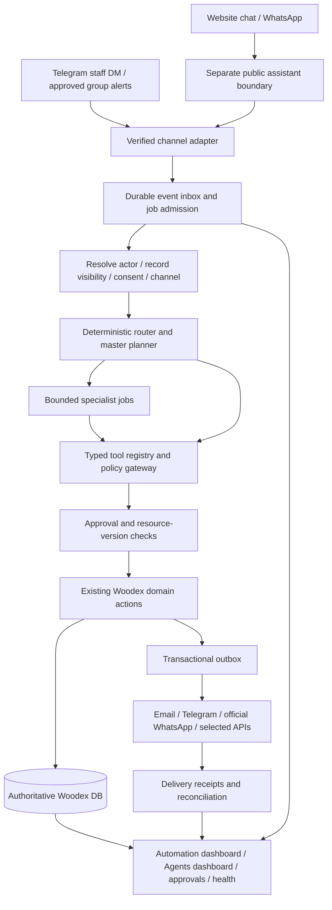

# Woodex Master — Telegram, agents and end-to-end automation architecture

**Planning baseline:** 17 October 2026, Asia/Karachi. **Status:** proposal, not implemented or authorized for deployment.

Companions: [implementation audit](21-OPERATING-SYSTEM-AUDIT.md) · [completion backlog](23-AUTOMATION-COMPLETION-BACKLOG.md).

## 1. Decisions already confirmed by the owner

- Audit + master plan now; no new business features in this task.
- Telegram master may **read and propose**. Important writes, sending quotations/messages, finance, publishing, permissions and destructive actions need explicit approval.
- Compare current Hostinger-only cron/official APIs with an optional separate worker; do not silently add a daemon/Node/Redis requirement to current hosting.
- Balanced rollout: common event inventory, permissions, approvals, observability and **separate Automation and Agents dashboards before specialist agents**.
- Preserve optional 2FA enrollment **for owner accounts only**; preserve confirmed authenticator challenges and enforcement for other staff. Telegram linking never silently mandates new 2FA.
- Reuse CRM/Sales/Projects/Website actions and business rules. Do not create a second CRM, a second client database or a separate financial ledger.

**Product principle:** Woodex Master is an authenticated control interface to Woodex OS, not a new all-powerful account and not this development chat automatically connected to production. A model/API provider must be separately selected, configured and accepted. It gets only explicit registered capabilities.

## 2. What “control the whole OS” means

The master can discover the user's permitted capabilities, answer questions, prepare a plan, route specialist work, request approvals, execute allowed actions through the server, and link back to records/dashboard runs. It cannot bypass a state guard because the owner is chatting, impersonate an accountant, invent bank confirmation, execute arbitrary SQL/PHP/shell, change its own permissions, retrieve secrets, or deploy code.

Start with deterministic commands. Natural language becomes a constrained translation to those same tools, **not another implementation of business rules**.

Public assistant context and staff context are **separate even when using the same model**. Visitors cannot invoke staff tools or gain finance access by claiming a phone number or pasting a Telegram message. Client-specific documents require the existing signed-link/portal verification boundary. Retrieval returns only published public facts to visitors.

## 3. Layers and responsibilities

| Layer | Responsibility | Reuse / new work |
|---|---|---|
| Domain records/actions | One source of truth for contacts, opportunities, quotes, invoices, payments, projects and pages. | Reuse existing modules; fix audit integrity findings first. |
| Channel adapters | Verify signatures, normalize full batched payloads, identify provider/account, persist event, acknowledge fast. | Extend Telegram/WhatsApp; new public chat adapter. |
| Event/automation runtime | Event subscription, trigger conditions, business-hour waits, enrollment/step state, stop rules, retries/dead letters. | New shared layer; wrap existing SLA/reminder/review jobs rather than duplicating them. |
| Tool/policy gateway | Schema validation, actor permission AND record visibility AND action state, rate/cost limits, approval requirement. | New adapters over actions. Existing actions do not all authorize their callers: every entry point must. |
| Approval service | Exact proposal preview, eligible approver, expiration/resource fingerprint, decision, single consumption, audit. | Extend quote approval concepts without treating quote-discount approval as generic send/finance approval. |
| Master planner | Intent → permitted tools/steps; ambiguity clarification; specialist routing; progress/result summary. | New bounded runtime. Deterministic routing for known commands, model only where useful. |
| Specialists | Analyze/draft within an explicit tool/data scope; return proposals and citations/evidence. | New, staged rollout; not seven persistent looping daemons. |
| Delivery/accounting | Outbox, recipient/category/window/consent checks immediately before send, provider ID/status, retry/reconcile. | Existing gateways plus durable delivery ledger. |
| Operator surfaces | Separate dashboards, integrations/settings, incident controls and auditable approval inbox. | Extend current TailAdmin/Livewire shell; new pages described below. |

## 4. Proposed data contracts

These names are **design targets**, not current tables. Final migrations follow existing naming/UUID/public-ID conventions. Keep private media private; operational logs hold metadata/redacted summaries, not copied credentials or full provider bodies.

| Proposed record | Core fields / constraints |
|---|---|
| `automation_events` / normalized existing `webhook_events` | Provider/account/external-event ID, event type/version, record reference, occurred/received times, correlation/causation ID, payload pointer/hash, processing state. Unique `(provider, account, external_id)`; preserve each batched event separately. Extend existing webhook table where practical, do not duplicate ingestion. |
| `automation_definitions` + immutable versions | Name/key, trigger, constrained conditions, ordered steps/waits, business-time policy, stop rules, recipient limits, owner, draft/published/paused state, schema/version. No arbitrary PHP/SQL or expressions that execute code. |
| `automation_enrollments` | Definition version, subject/contact/conversation, trigger event, status, next due time, pause reason; unique trigger/subject/version admission key; pinned policy/version. |
| `automation_steps` / attempts | Enrollment, step/version, due/claimed times, worker lease/heartbeat, idempotency key, attempts/error class, input/output references, duration, skip reason; indexed due-state queue. |
| `action_proposals` / `action_approvals` | Requester/actor, tool/version, target/recipient/channel, exact payload fingerprint, resource version, amount/currency, cost ceiling, risk, approver policy, expires/decided/consumed timestamps. Single-use consumption in the same transaction as the action. |
| `outbox_messages` / `delivery_attempts` | Committed event reference, channel, recipient reference, template/version/category/language, unique business send key, approved payload hash, state, provider ID, error class, next retry, delivered/read timestamps; separate one-to-many attempts. |
| `agent_definitions` / versions | Agent purpose, tools/field masks, knowledge sources, prompt version, provider/model allowlist, budget/turn/time limits, modes and owner. Credentials reference secret storage, never prompt text. |
| `agent_runs` / `agent_steps` | Actor/channel/trigger, goal, pinned prompt/model/tool versions, tool calls/approvals, state, citations, usage/cost, execution budget, correlation/parent run ID. Store a short decision summary, not hidden chain-of-thought. |
| `knowledge_documents` / chunks | Source/version/permission/publication scope, language, approved text/hash, indexed time, retrieval provenance. Delete/unpublish revokes retrieval access immediately. MySQL full-text first; vectors only if evaluation justifies. |
| `usage_ledger` / effective-dated rates | Provider/account/model/category/recipient market, estimated and actual units/cost, billing currency, price version/free-tier period, reconciliation source. Usage rows idempotent; account-level free tiers counted once. |
| `integration_health_checks` / incidents | Capability, configuration vs authenticated result, checked time, token expiry/last webhook/last success, redacted error, incident ownership and recovery acknowledgement. Do not equate webhook silence with outage without expected traffic. |

### State machines

- Automation: `draft → active → paused → retired`; individual enrollment: `scheduled → running → waiting_time / waiting_approval / waiting_human → completed / canceled / failed`.
- Step/delivery: `pending → leased → succeeded / retry_due / failed_permanent / unknown_outcome / skipped`. Provider timeout after sending is **unknown**, not safe-to-resend.
- Approval: `proposed → approved / rejected / expired / canceled → consumed`; changed resource/payload invalidates approval. Decision history immutable.
- Agent run: `queued → running → awaiting_approval / awaiting_human / retry_due → completed / failed / canceled / budget_exceeded`.
- Bot/human conversation ownership: `bot → handoff_pending → human → bot` only after explicit release; new message during human ownership must not trigger a competing bot response.

DB writes + outbox admissions are atomic; notification dispatch happens after commit. Files/PDFs need temporary artifact promotion or compensating cleanup if transaction fails. Use row locks/fresh-state checks and unique business keys; “exactly once” describes the local protected business effect, not guaranteed delivery over a remote network.

## 5. Tool registry: reuse, don't rebuild

Illustrative tool names below are **not current public endpoints**. Read-only tools can initially use/extend current MCP query services without widening existing tokens. Staff writes use authenticated server-side policies and proposal endpoints.

| Tool family | Reused implementation / authority | Default access |
|---|---|---|
| `status.read`, `lead.list/get`, `quote.list/get` | Existing read-only bridge + visible-to queries. | Current scoped identity; minimum fields, bounded pagination. |
| `today.read`, `visits.list`, `receivables.read`, `project.get`, `health.read` | Queries shared with existing screens/new reports, not screen scraping. | Role + record visibility; finance and system diagnostics masked separately. |
| `lead.capture`, `lead.assign`, `lead.note`, `lead.next_action`, `lead.stage` | `CaptureLead`, `AssignLead`, `LogLeadActivity`, `SetNextAction`, `MoveLeadToStage`. | Public capture narrow input only; staff writes proposed/confirmed. Cannot override pipeline guards. |
| `visit.slots`, `visit.propose`, `visit.book` | Extend internal availability; `ScheduleSiteVisit` / `UpdateSiteVisit`. | Client confirms a real slot; authoritative conflict recheck. |
| `quote.draft`, `quote.edit`, `quote.revise`, `quote.approval.request/decide`, `quote.send` | `CreateQuote`, `QuoteEditor`, `ReviseQuote`, `RequestQuoteApproval`, `DecideQuoteApproval`, `SendQuote`. | Draft-only specialist; quote discount approval and external sending are distinct gates. |
| `invoice.draft/issue`, `payment.propose/verify`, `receipt.get`, `statement.read` | Existing and completed finance actions after repairs. | Finance-role approval; proof/OCR never confirms funds. Secure web confirmation initially. |
| `project.stage/propose_update/share`, `handover.propose`, `case_study.draft` | Existing project/update/handover/case-study actions. | Stage/share approvals; case studies need photo and publication consent. |
| `website.audit`, `page.draft`, `page.diff`, `page.publish`, `page.rollback` | Website audit, `SavePage`, `PageValidator`, `RestorePageVersion`, renderer/cache. | SEO agent draft only; human publisher approves exact diff. URL/robots/global navigation changes elevated. |
| `automation.inspect/propose_pause`, `agent.inspect`, `integration.health` | New control services; reuse health/logs/config diagnostics. | Operators may inspect allowed runs; global kill switch owner/admin only. |
| `idea.create`, `issue.create` | Existing change-request path, extended with safe attachments. | Linked active staff; explicit attribution, no hidden deploy or code edits. |

Every tool advertises JSON schema, returned-field mask, risk, policy, side effects, timeout, idempotency strategy, approval policy, actor impersonation prohibition and supported domain states. Tool output is data, never higher-priority instructions.

## 6. Approval policy and Telegram safety

### Risk/action matrix

| Risk | Examples | Initial rule |
|---|---|---|
| Read | Own leads/tasks, current quote status; allowed reports. | No write approval, but normal permission + visibility and PII masking. Sensitive reports DM-only. |
| Internal draft | Draft quotation/content/reply/next-step proposal. | Explicit user request or approved event rule; autosave only as a draft with run/source attribution. No client message. |
| Important operational write | Assign/reassign, stage/visit changes, contact merge, project sharing. | Preview + confirmation by eligible staff; merge/elevated actions web confirmation. |
| External communication / commercial commitment | Quote send, client reply, campaign, published content. | Exact recipient/content/version/cost preview and explicit approval. Low-risk FAQ replies may become pre-authorized only under owner-approved bounded channel policy after evaluation. |
| Finance | Record/verify payment, issue invoice/receipt, allocate credit. | Authorized accountant/owner confirmation; initially secure web finance screen. Telegram proposes and deep-links, never verifies a screenshot by itself. |
| Sensitive administration / destructive | Roles, secrets, bank changes, refund/void, mass erase/restore, deploy. | **Never execute directly from Telegram or AI tools initially.** Web-only role/reauth controls and independent audit; no generic “approve all”. |

Normal staff identity/permissions cap what the agent may do; owner status must not skip business-state/approval checks. Preserve current owner 2FA choice: sensitive web step-up uses existing authentication policy/reauthentication, not forced authenticator enrollment from a Telegram link.

### Callback protocol

1. Verify provider header, persist update, reject malformed/oversized payload. Bind Telegram **sender ID** to an active staff record. Group chat is a destination, not an identity.
2. Resolve explicit command/read scope; respond with limited results and HTTPS admin record links. For NLP, ask a question if record/recipient/amount is ambiguous.
3. Prepare proposal: exact action, target, recipient, channel, quote revision/resource version, amount/currency, approval reason, cost cap and expiry. Persist server-side.
4. Telegram button carries only a short opaque nonce/reference fitting provider callback limits, not serialized trusted action JSON. Bind nonce to proposal + sender/approver + permitted chat. Default approval TTL suggested **15 minutes**, configurable; read links separate. No PINs or secrets in bot messages.
5. On callback, resolve sender again, authorize fresh role and visibility, compare payload/resource fingerprint, enforce unconsumed nonce/expiry/rate limits, then execute and consume atomically. Changed discount/recipient/content requires a new proposal.
6. Return committed result ID and delivery status separately: “quote version frozen; delivery queued” vs “delivered”. Duplicate/forwarded/replayed callbacks do not execute again.
7. Finance/publishing/admin-sensitive cards open a signed-in web review; a Telegram acknowledgement is not bank verification or web authorization. Reject/cancel/expiry logged; no silent auto-approval after waiting.

Disable writes for unlinked/inactive senders, unknown group members, edited/replayed old commands, stale callbacks and job/actor permission changes. Voice/photo commands become transcribed/extracted **draft proposals** with retention and malware/file checks; uncertain names/amounts require correction.

### Initial command rollout

| Stage | Commands / behavior |
|---|---|
| Existing baseline | `/start CODE`, `/link CODE`, `/help`, text `/idea`, `/issue`; not a complete command centre. |
| Read-only first | `/today`, `/leads [mine\|new\|unassigned]`, `/lead <reference>`, `/find`, `/quotes`, `/quote`, `/due`, `/visits`, `/report`, `/health`, `/approvals`, `/runs`, `/agents`. Finance/system commands restricted; no full client dumps in groups. |
| Approval-gated operations | `/assign`, `/note`, `/next`, `/draftquote`, `/approve`, `/reject`, `/pause` and natural-language equivalents → proposal workflow. Staff can ask “prepare a quote”, not force a send by wording it as an instruction to the model. |
| Notifications/digests | Configurable alert matrix; daily 09:00, weekly Monday 09:00 and monthly 1st as proposed defaults. Respect business days/quiet hours, scope/recipient preferences, critical routing and `/mute`. Existing saved digest time is not proof these jobs exist. |

Example: “Follow up on yesterday's viewed quotes” → authorized report → choose eligible recipients with no reply/opt-out/acceptance → draft messages/cost → approve campaign or individual sends → recheck eligibility immediately before each send → delivery ledger → Telegram summary with failed/skipped/unknown counts.

## 7. Specialist agent roster

Each is a versioned job profile with an allowed data/tool set and an owner. All start in **read/draft or shadow mode**. Shared policy/sequence/runtime services remain deterministic.

| Agent | Goal / inputs | Allowed work | Escalates / cannot do | Success measure |
|---|---|---|---|---|
| **Master coordinator** | Staff goal, domain events, approval/incident state. | Break bounded goal into jobs, dispatch specialists, summarize grounded results, request approvals. | Ambiguity, permission/cost violations, conflicting proposals; cannot grant tools/override approvals. | Correct tool routing, useful approved proposals, no unauthorized effect. |
| **SEO/content** | Published CMS facts, current URL map, website audit, later GSC/GA4. | Detect missing metadata/links/alt/duplicate content; propose typed CMS drafts/diffs; approved case-study enrichment. | New factual claims/addresses/testimonials; URL/robots/schema/global changes need publisher review; no ranking guarantees. | Approved fixes, zero URL regressions, measured organic conversion rather than invented scores. |
| **Lead intake/qualification** | Opted-in website/WhatsApp enquiry and public knowledge. | Collect service/location/property/size/timeline/name/contact, preserve attribution, call central capture once qualified, propose callback/visit. | Negotiation, complaints, existing payment/project questions, low confidence, no-consent outreach. | Qualified lead completeness, source preservation, dedupe and response SLA. |
| **CRM hygiene** | Allowed lead/contact/task/visit records. | Detect missing next action/stale ownership/duplicates; draft notes/tasks/merge/reassignment proposals. | Bulk merges/deletions/ownership changes without approval; never creates second lead logic. | Fewer overdue/no-owner leads; zero cross-client merges. |
| **Live-chat/support** | Single verified conversation, approved knowledge, permitted contextual public facts. | Grounded EN/Urdu/Roman Urdu replies, summary/translation and handoff; staff suggested replies. | Human requested, low confidence, angry sentiment, price/date commitment, private document request or turn cap. | Handoff correctness, answer grounding, reply SLA and no leakage/bot-human collision. |
| **Sales/follow-up** | Quote state/views, prior replies/visits, consent and sequence eligibility. | Draft quote/follow-up/call tasks, propose reissue or options; recommend timing within business policy. | Discounts/terms/promised timelines; client send approval; stop on reply/accept/decline/paid/opt-out. | Visit→quote time, eligible follow-ups, conversion without excess messaging. |
| **Finance/collections** | Restricted invoice/payment/receipt/aging data. | Read reconciliation/aging, draft invoice/reminder/allocation anomaly proposals. | No bank-truth inference from image/OCR, no autonomous payment confirmation/refund/void, no broad bank detail retrieval. | Reconciled balances, overdue reduction, zero false payment confirmations. |
| **Project/client updates** | Assigned project milestones, approved notes/photos and client visibility policy. | Draft progress updates, handover reminders, invoice-draft proposals, consented case study drafts. | Private snag/internal-cost disclosure; no auto-invoice issue on milestone; no client update/publish without approval. | Timely approved updates, accurate progress and satisfied handover. |

Lead/chat roles may share a runtime profile but must retain explicit conversation ownership and distinct staff/public permissions. No agent may recursively spawn unlimited agents or send another agent's unapproved proposal as a workaround.

## 8. Full funnel: trigger, action, approval, stop and outcome

| Step / event | Deterministic backbone + agent assist | Human/control point | Observable result |
|---|---|---|---|
| 1. Website/chat/WhatsApp arrival | Verify and persist input; bot asks one relevant qualification question at a time using approved knowledge. | Consent, spam protection, unknown user unprivileged. | Event/conversation ID, source/page/campaign and privacy flags. |
| 2. Qualified enquiry | `CaptureLead` normalizes/matches contact and reuses/creates the opportunity; assignment/scoring/SLA already exist. | Client is a prospect, **not a paying client yet**. Explicit opt-in distinct from service response permission. | Lead ref, contact link, fields/attribution/timeline, staff notification delivery state. |
| 3. Response/callback/visit | Tasks and next action via existing actions; offer authoritative slots after availability service. | Staff assignment/reassign confirmation; client confirms real slot; atomic clash check. | Visit record, client confirmation, staff/client D−1/2h reminder runs. |
| 4. Outcome → proposal | Measurements/outcome feed draft quote from approved template/rate book. | Sales verifies quantities/scope/prices and margin; specialist cannot promise final price. | Draft/revision with calculator totals and confidence/missing-fields checklist. |
| 5. Approval + send | Existing fingerprinted commercial approval, then separate approved transport send. | Eligible manager/owner discount approval; exact revision/recipient/content/cost approval. | Immutable quote snapshot/PDF; provider message ID/delivery, not just `sent` row. |
| 6. View/follow-up/revision | First/hot views already logged; sequence D2/D5/D12 (proposed); revisions via existing action. | Stop on reply/changes/accept/decline/lost/opt-out; no timer-only spam. | Enrollment/next-step/delivery status, call task or handoff; old PDF preserved. |
| 7. Accepted | Existing acceptance transaction marks client/won, opens project, raises configured advance draft/issued invoice. | Idempotency + latest accepted revision; send/issue policy explicit; reject expired/stale link. | Exactly one project/advance effect, acceptance proof and timeline. |
| 8. Invoice/proof/payment | Owner/accountant reviews and issues/sends; client upload creates pending claim. | Human bank verification; protected allocation/credit policy; receipt on confirmed funds only. | Immutable issued invoice, verified payment/allocation, stable numbered receipt and delivery. |
| 9. Collections | Effective balance/aging + approved D−3/D0/D+3/D+7/D+14 sequence. | Stop on paid/void/dispute/pending human review/opt-out policy; late escalation to owner. | Amount reconciles; report separates contacted, skipped, pending approval and overdue. |
| 10. Project delivery | Existing stages/progress/private updates/portal; milestone reached can propose an invoice draft. | **D-88 preserved:** milestone reach itself never issues invoice; share only client-approved content. | Authorized portal timeline, approved update delivery, draft milestone invoice. |
| 11. Handover/review | Existing checklist/client OK; configured review delay, approved review channel. | Verify consent and review URL; missing address/config is skipped, not delivered. | Handover proof/review status; consented case-study draft only. |
| 12. Completion/report | Reconciled invoice/payment/credit/project/lead outcomes; master summarizes. | Outstanding balance/dispute not hidden by “project complete”; owner accepts final report. | Linked funnel/cohort/collections metrics and audit trail. |

Lost leads enter nurture only with lawful marketing consent and approved cadence. New client reply immediately exits sales follow-up and transfers to a human/appropriate agent. Before every delayed send, re-read current eligibility inside a contact-level send lock so a just-arrived STOP/payment/acceptance wins over stale enrollment state.

## 9. Separate dashboards and settings

**All paths below are proposed new UI, not existing routes.** Use TailAdmin/Livewire components, real persisted state, mobile-friendly lists and filtered drill-downs. Reuse current `/admin/integrations`, `/admin/health`, notifications and business record screens.

### Automation dashboard — `/admin/automations`

- Overview cards: active/paused definitions, due/running/waiting-approval enrollments, failed/unknown deliveries, oldest queue age, missed schedules; all link to filtered lists.
- Tabs: **Overview · Workflows · Enrollments · Runs/steps · Deliveries · Approvals · Incidents**. Distinguish business workflow version from scheduled operational job.
- Workflow detail: version, trigger/conditions, editable constrained steps/waits/stop rules, business hours/holidays/quiet hours, contact caps, owner/channel/provider dependencies, dry-run preview, publish and rollback.
- Run detail: record/contact links, causation chain, due/claim/attempt timestamps, sanitized inputs/output, channel delivery, skip/error/unknown reason, next attempt; every change attributed.
- Controls: pause/resume/cancel future steps, safe retry, resolve unknown after provider reconciliation, dead-letter review; **never blind retry a successful or uncertain external send**.
- Central approval queue: amount/recipient/content diff/resource version, risk, eligible approver, TTL, approve/reject/open secured web review. Finance/admin data masked by role.
- Global emergency **stop new external sends** and **pause new enrollments** are separate controls; inbound ingestion remains on. In-flight sends may still complete and must be reconciled.

### Agents dashboard — `/admin/agents`

- Agent cards show purpose/owner, disabled/shadow/draft-only/approval-gated mode, active runs, model/provider, allowed tools and budget. “Working” requires a live lease/heartbeat, not a static green badge.
- Run log shows queued/running/waiting/failed/completed/canceled, staff/conversation/goal/linked records, durations, tool approvals/results, source citations, model/prompt versions, tokens and **estimated vs actual** cost.
- Detail/settings: persona and policies versioned; knowledge scope; tools and field masks; data retention; provider/model fallback; max steps/tools/retries/time; per-run/day/month budgets; escalation owner; quiet hours; simulation/evaluation history.
- Controls: test in sandbox, enable shadow, promote to draft, request limited auto-reply policy, pause/cancel; permission reduction takes effect at each tool call. No model may edit its own tool allowlist or cost ceiling.
- Evaluation screen: grounded answers/qualification accuracy/handoff/tool permissions/PII/cost/latency; compare approved versions on the same fixture set before promotion.

### Integration settings and business reports

- Provider cards: **not configured / configured-unverified / connecting / healthy / degraded / expired / revoked**, verified capability list, account/resource, last check/event/success/error, scopes, expiry and setup/test/revoke controls.
- Separate staff login Google vs company connection vs each Workspace capability. Separate local MCP client setup from production HTTP bridge.
- Reports: lead/visit/quote/won funnel and drop-offs, source/owner, response SLA, invoiced/collected/credit/aging, agent-attributed proposals and human-approved effects. Date range and timezone visible; export obeys permissions.
- Cost view: AI token usage by agent/model; WhatsApp **delivered** category/market charges/free-tier allowance; email/realtime/storage/worker quotas; budget warning and hard stop. Never add two competing meters for one send.

## 10. Hostinger-only vs optional worker

| Dimension | A — Existing PHP/MySQL + cron / official APIs | B — Same authoritative OS + approved external worker/realtime |
|---|---|---|
| Application/data | Current Laravel, Livewire, one MySQL database. | Same; no second CRM/Auth/Supabase required. |
| Runtime | No daemon/Node/Redis on current shared host. Bounded DB queue drained every minute. | Worker on separately approved infrastructure, supervised/restarted; PHP or another runtime as needed. Explicit exception to current hosting rule, not assumed available. |
| Telegram reads / confirmations | Small authenticated read queries/proposal endpoints can answer promptly during request. | Same boundary; worker handles long AI planning/enrichment, not bypasses policies. |
| Webhook intake | Verify/persist/ack <2s; heavy media/AI/send work async. | Same intake; prompt job pickup and durable leases after ack. |
| Bot/follow-up latency | Queue pickup can wait nearly a minute and longer under load; not a sub-5-second live assistant guarantee. Polling UI can update every 5s without the AI response being ready. | Suitable for near-real-time pickup; model/provider latency still measured. Managed Pusher/Ably optional; does not by itself make cron jobs faster. |
| Workload fit | Staff alerts, schedules/digests, low-volume operations, reports, draft jobs and a transparent delayed-assistant mode. | Interactive AI chat, many concurrent conversations, longer media/OCR/indexing jobs, sustained backlog or strict reply SLA. |
| Operational burden | Lowest extra infrastructure, but host CPU/process/inode/cron ceilings and scheduler overlap matter. | More health checks, deployment/lease recovery/secrets/network/cost management; optional provider outages isolated from core records. |
| Browser networking | Relative application URLs; polling through application auth. | Same browser URLs; server-to-worker bridge or managed realtime auth. Browser never calls sandbox `localhost` or a private worker port. |
| Failure/recovery | Cron dead-letter/retry controls + external heartbeat monitor. | Worker lease expiry/requeue + watchdog + the same outbox/idempotency/approvals. Cron fallback only for jobs explicitly safe on it. |
| Costs | Existing hosting, actual message/model/mail/storage usage. No invented all-inclusive price. | Those same costs **plus** worker/monitoring and optional realtime/queue service. Provider quote and hosting plan limits must be checked. |

### Recommendation

**Use A for foundation, P1–P3 completion, deterministic Telegram reads/approvals and initial shadow/draft agents.** It matches current code and hosting policy. Do not install a WhatsApp Web gateway, Redis, Node runtime or another CRM to achieve this.

**At public AI-chat rollout, make a measured hosting decision.** If Woodex needs human-like reply times (proposed p95 model answer ≤10s), choose B before enabling live automated conversations. If an honest delayed response of roughly one cron cycle is acceptable at low volume, A can pilot with an immediate acknowledgement, clear human fallback and measured queue age. Do not call either scenario realtime merely because a widget exists.

A worker can lease scoped tasks over an authenticated TLS API and return structured results/proposals to Woodex. Use short-lived service credentials, leases/nonces/audience checks, minimal redacted context, approved provider secret storage and a revocation/kill switch. **No public MySQL exposure, broad staff token, production DB password or direct domain-table writes from an external model worker.** API executes approved authoritative domain actions. Any decision to run the full Laravel worker against the same database instead requires a separately reviewed private-network/secrets deployment design.

Promotion triggers to consider: required latency cannot be met, oldest interactive job age exceeds target, cron runs overlap/overrun, host CPU/process budgets saturate, or sustained concurrency causes handoff misses. Set thresholds from a load test, not fabricated current traffic. Preserve one executor claim per step to prevent worker + cron double processing.

### Cost and capacity model

Monthly incremental cost = AI usage + delivered WhatsApp chargeable usage + any email/realtime overage + storage/offsite backup + optional worker/monitoring. Show actual billing currency and separately labeled PKR display conversion/date.

- AI = input/output/cache/embedding units × effective provider/model rates; record estimates before approval and actual usage after response. Cap run, agent, conversation and organization budgets atomically under concurrency. No unlimited agent loops.
- WhatsApp = billable delivered messages grouped by account/market/category/effective date/volume tier/free allowance. Reconcile to official provider usage, including unknown delivery and category changes. The original plan's old fixed example is not a validated bill.
- Polling load ≈ active visitors/staff × polling frequency × query cost. Paginate incremental `after_id` changes, back off hidden tabs, bound visitor sessions, and load-test alongside cron/PDF jobs.
- Suggested starting safety defaults for owner review: max 3 tool calls per public turn, 10 steps per staff run, 2 retries for safe reads, short provider timeouts, conservative contact message caps. **No automated retry of uncertain writes.** Monetary budgets and provider prices must be selected before enabling paid runs; this plan does not approve a spend amount.

## 11. Reliability, security and data lifecycle gates

1. **Durable admission:** verified batch → unique stored event → dispatch claim. Crash between persist/dispatch is recovered by a sweeper. Failed/replayed events are re-drivable without losing idempotency.
2. **Scheduling:** Karachi business-time calculations, holidays, quiet hours, contact timezone where known, DST for external calendars; pin due times and recalculate policy changes deliberately. Bound each cron batch; index due records; prioritize intake/handoffs over bulk marketing.
3. **Retries:** classified network/rate-limit/permanent errors, exponential backoff/jitter/Retry-After; circuit breakers by provider. Reconcile ambiguous sends before retry, never replay whole enrollment blindly.
4. **External watchdog:** cron cannot detect its own complete absence. Independent monitor of heartbeat/queue age and a fallback email/dashboard channel if Telegram is the failed integration. Use synthetic webhook checks only with safe non-business fixtures.
5. **Least privilege:** actor active at every step, own/team visibility, tool-specific permissions, DM-only finance, separate public context; deactivation/token revoke stops later tool use. No raw SQL/export-all tools.
6. **Injection/SSRF:** user text, PDF, website copy, tool output and retrieved documents are untrusted. Separate instructions from data; allowlist tool names/schema; no arbitrary URL fetch/browser/shell; any approved URL importer validates public destination at every redirect, resource budget and MIME.
7. **Files:** size/type sniffing, malware quarantine where available, private storage, signed downloads, no executable uploads; redact/transcribe voice/photo only after policy consent. OCR labels extracted suggestions, never payment verification.
8. **Privacy:** minimize model-bound PII, document external processors/retention; explicit opted-in marketing; separate service response from campaigns; contact export/erase must cover transcripts/knowledge/run artifacts/attachments/backups policy. Logs retain references and masked values, not tokens/codes/bank screenshots.
9. **Versioning/rollback:** pin workflow/prompt/tool/knowledge versions per run; publish/restore existing CMS versions; cancel/reapprove stale queued writes after rollback. Messages already delivered cannot be unsent by reverting a database transaction.
10. **Quality:** grounded multilingual evaluation and red-team fixtures before production promotion. Track hallucination/incorrect-tool/handoff/privacy/cost/latency; use deterministic rules for money/permissions and calibrated human escalation, not a model's self-reported confidence alone.

## 12. Phased execution and acceptance gates

The detailed tickets and dependencies live in [doc 14](23-AUTOMATION-COMPLETION-BACKLOG.md). Phase labels below are **new delivery batches A0–A8**, not a rewrite of historical P0–P9.

| Batch | Order / contents | Exit gate |
|---|---|---|
| **A0 — establish truth and close integrity risks** | Baseline/live evidence; F01–F07 finance/webhook fixes; permission/consent review. | Negative and replay tests pass, stable receipts and reconciled balances, batched webhook event retention; no automated important writes enabled. |
| **A1 — finish the sales spine + common runtime** | P1/P2/P3 gaps, financial migration; event/outbox/sequence/approval/health framework. Parallel tracks share domain actions. | Provisional admin/email enquiry→receipt and migration fixtures accepted; reliable stop-aware scheduler/delivery log. Full original R1 Telegram/channel and final migration acceptance wait for A2/A3 and B71. |
| **A2 — control surfaces + deterministic Telegram** | Automation/Agents dashboards/settings, actor-safe Telegram reads/approval cards/digests and MCP acceptance. | Owner completes a real test day of permitted reads/proposals; expired/forwarded/stale/role-revoked approvals fail closed; dashboards show real queued/failed/paused states. |
| **A3 — conversational funnel** | Official WhatsApp readiness/templates/consent/usage; public chat/qualification/handoff; visits; quote and invoice sequences. Select A vs B hosting gate. | Unknown visitor/WhatsApp contact qualifies once, human takeover silences bot, STOP/reply/accept/paid stops sends, window and pricing rules enforced, real delivery receipts. |
| **A4 — bounded specialists** | Provider/knowledge/evaluation; lead/chat/CRM/sales, then finance/project draft agents under master. | Shadow comparison passes; no unauthorized writes/data leakage; budgets cap concurrency; approved draft→action trace complete. |
| **A5 — SEO + Google business tools** | Public fact/SEO agent, real identity OAuth, GA/GSC read-only, Calendar then chosen Drive/Sheets/Meet/Gmail. | Current URL parity/no-JS/SEO gates, exact publisher diff approval, least scopes and refresh/revoke tests; no false “connected Workspace” claims. |
| **A6 — marketing and optional channels** | Segments/broadcasts/Meta/IG/LinkedIn, optional Notion/Slack/Zoom. | Granted permissions, actual signed lead→CRM and approved scheduled publish; consent/caps/cost and fallback when approval unavailable. |
| **A7 — optional finance/deeper project extensions** | Gateways, project costs, realtime/worker optimization only if selected. | Settlement reconciliation/refund controls and target latency/capacity proven; no extra runtime implied without approval. |
| **A8 — operational handover** | Restore/load/security/retention/evaluation, staff training, phased deployment and sign-off. | Restore drill, incident/kill-switch recovery, accepted business metrics, owner/accountant release certificate and rollback route. |

### Release acceptance suite (must be evidence-backed)

- **Sales:** real enquiry → assigned alert → call/visit → measured BOQ → approved discounted quote → verified delivery/view → client acceptance → one project/advance → proof → accountant verification → stable receipt → collections/ledger reconcile.
- **Migration:** repeatable source/target counts, duplicate exceptions, zero unexplained money delta/orphans, attachments and numbering continuity; actual accountant sign-off.
- **Telegram:** active sender identity including groups, no group privilege inheritance, per-command visibility, callback tampering/replay/expiry/resource change, staff deactivation and TOTP policy preserved; finance/admin handoff secure.
- **Channels:** forged HMAC rejected; full batched webhooks, crashes/replays/status ordering/rate limits/redrive; email/WhatsApp real delivery; phone opt-out cannot be overridden by a stale step.
- **AI:** EN/Urdu/Roman Urdu grounding, nonexistent pricing/date requests, prompt injection/private-data tests, complaint/negotiation/human handoff, exhausted budget/provider outage, stopped bot ownership; trace every actual effect to an approved tool.
- **Operator UI:** populated and empty states on desktop/mobile, keyboard permissions, expired approvals, partial/failed/unknown deliveries, pause/resume/cancel and budget details; no fake status/cost badges.
- **Website:** current URL map parity and old homepage mismatches resolved deliberately; no-JS enquiry, accurate public booking/chat states, cache-safe visitor token, no private record leakage; publish/rollback diff gate.
- **Operations:** cron and optional worker heartbeat/queue-age thresholds, provider-down fallback, restore to isolated environment and migration rollback rehearsal, retention and secret redaction checks.

## 13. Next implementation handoff

Start a new coding session with **A0 / B01–B08**. Carry the existing working-tree Google/Telegram/MCP changes forward; do not reset them or ask for already saved Telegram secrets. Ask for any newly necessary decisions, then work one accepted batch at a time. Publish only after separate owner approval and actual deployment/migration/provider acceptance. No step in this document itself changes production.
